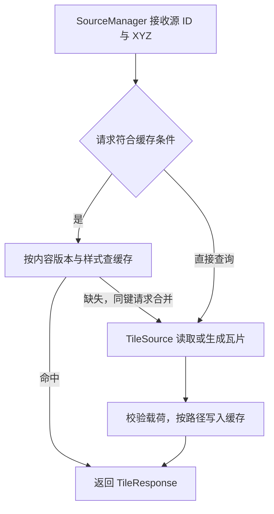

# 架构与生命周期

`maptile-core` 将数据访问、瓦片缓存、样式处理和地图渲染组织为可组合的 Rust 模块。应用构造具体数据源与配置，管理这些对象的生命周期，并将库返回的字节、元数据或图像接入自己的交互与服务流程。

公共模块见 [`src/lib.rs`](../src/lib.rs)，常用类型的导出入口见 [`prelude`](../src/prelude.rs)。

## 组件职责

| 组件 | 职责 | 应用的接入点 |
| --- | --- | --- |
| `TileSource` | 统一源标识、TileJSON、瓦片响应和关闭接口 | 实例化内置源，或实现自定义源 |
| `SourceManager` | 按 ID 管理源，协调缓存和查询，生成目录快照 | 注册、替换、查询与下线源 |
| `TileCache` | 按字节计权存储瓦片，管理 TTL/TTI，合并同键并发读取 | 配置缓存容量和有效期 |
| `filter` | 解析和验证 CQL2 属性条件，生成 SQL 片段 | 配置可查询字段和源的过滤路径 |
| `styles` | 读取样式、生成样式目录、重写资源 URL | 提供样式路径和应用资源地址 |
| `raster` | 解析并执行栅格样式相关处理，提供图像编解码组件 | 配置波段、色带、输出与重采样 |
| `render` | 构造地图请求、生成 WMTS 元数据；按 feature 执行原生渲染 | 创建渲染池，提交静态地图或瓦片请求 |
| `transport` / `transcode` | 压缩编解码与矢量瓦片格式转换 | 按响应编码和目标格式处理字节 |
| `discovery` / `watch` | 扫描文件，通知目录变化 | 将文件发现结果转换为具体数据源 |

应用层维护 HTTP 路由、鉴权、配置加载和资源地址，将这些上下文转为核心库需要的类型。字体和精灵图通过样式中的 glyph/sprite URL 接入，应用负责提供可访问的资源。

## 瓦片读取过程

管理器根据查询内容、源的缓存层级策略和已配置缓存，选择读取路径：

缓存条件包括：管理器已关联缓存、源的 `cache_zoom()` 包含当前层级，以及查询属于可缓存的输入组合。`filter`、`bbox` 和 `url_query` 走直接查询路径；样式与镶嵌像元选择参与缓存身份。实现和对应回归见 [`manager.rs`](../src/sources/manager.rs)。

`TileResponse` 携带实际字节、格式、压缩编码和可选修改时间。应用按本次响应的 `info` 处理结果。ETag 读取通过 `get_tile_with_etag` 返回新载荷及验证标识，或返回 `NotModified`。

批量导出或归档构建可直接调用 `TileSource::read_tile_batch`。每次最多提交 128 个坐标，按 8 MiB 累计预算返回有序前缀，空瓦片保留其位置。非空请求至少返回一个结果，因此首张瓦片可占用超过累计预算的空间；调用方按已返回的长度继续剩余坐标。该入口直接读取源，具体预算和默认流程见 [`sources/mod.rs`](../src/sources/mod.rs)。

## 缓存身份与预算

[`TileCacheKey`](../src/cache/tile_cache.rs)由源 ID、内容版本、XYZ 坐标和样式散列组成。栅格输出的有效样式与镶嵌像元选择通过规范化散列区分；同一坐标的不同内容或样式可以拥有独立缓存项。

内容版本由数据源提供。归档和文件源使用文件身份、对象校验信息或打开代次；PostGIS 表源可结合应用持久化的编辑修订号。COG 的 `content_id` 由应用给出，适合使用版本化 URI 或数据版本标识。自定义源通过 `content_version()` 声明自己的内容身份。

`TileCache::new` 接收容量、TTL 和 TTI。容量参数按 MiB 换算，权重包含瓦片载荷、键和记录开销；进程容量规划还应计入连接池、渲染器、数据解码与其他分配。同一缓存键的并发缺失请求共享一次计算，错误保留其结构化类型。

`invalidate_source` 和 `invalidate_all` 发起失效操作，后台维护完成物理回收。测试可调用 `run_pending_tasks().await` 等待维护处理。实现见 [`tile_cache.rs`](../src/cache/tile_cache.rs)，样式与内容散列见 [`hashing.rs`](../src/cache/hashing.rs)。

## 数据源生命周期

| 操作 | 管理器行为 | 适用场景 |
| --- | --- | --- |
| `register(source)` | 按 ID 插入或替换；替换为新对象时对旧对象调用 `start_close` | 应用启动、更新源配置、发布新文件 |
| `remove(id)` | 移除源并发起 `start_close`，返回旧源引用 | 调用方继续管理旧源的关闭过程 |
| `close_source(id).await` | 移除当前源、失效其缓存并等待 `close` | 数据源下线、显式资源回收 |
| `mark_unavailable(id)` | 记录加载失败状态，移除活动源并发起关闭 | 区分加载失败与不存在的 ID |
| `require(id)` | 返回当前源，或返回对应的结构化错误 | 查询前解析源状态 |

具体的会话释放过程由源实现。GeoParquet 和 FlatGeobuf 的克隆共享会话，显式 `close().await` 用于等待查询、连接和读取资源退出，详见[矢量文件指南](geoparquet.md)。

替换源后，若应用还需要等待旧对象完全关闭，应在替换前保留旧引用，再对该引用调用 `close().await`。`close_source(id)` 操作的是调用时按 ID 注册的当前源。

## 文件发现与更新

[`discovery::scan`](../src/discovery.rs)与 `scan_async` 扫描数据和样式文件，返回发现报告；[`SourceWatcher`](../src/watch.rs)通知文件变更。应用保留 watcher 并消费事件，把发现信息交给自己的数据源工厂。

`reload_from_discovery` 根据 ID 同步新增与删除条目，已存在的 ID 保持当前对象。对已有文件内容或配置的更新，应用重新打开具体源，再调用 `register`。这让文件发布、元数据检查和内容版本更新具有明确的接入位置。

对于远程文件和对象存储，使用不可变、带版本的地址可以使数据快照与缓存身份保持一致。应用在发布成功后切换源，并按生命周期策略处理旧对象。

## 错误与观测

[`MaptileError`](../src/error.rs)区分源状态、瓦片查找、配置、过滤和后端错误。应用可依据错误变体决定响应、重试或记录方式，并在对外输出时处理内部连接和文件上下文。

关键读取路径使用 `tracing`。启用 `metrics` 后，缓存计数器在首次访问时注册到默认 Prometheus registry，应用负责抓取和暴露；指标定义见 [`metrics.rs`](../src/metrics.rs)。连接数、源数量和原生渲染队列容量由应用按部署预算统一配置。
