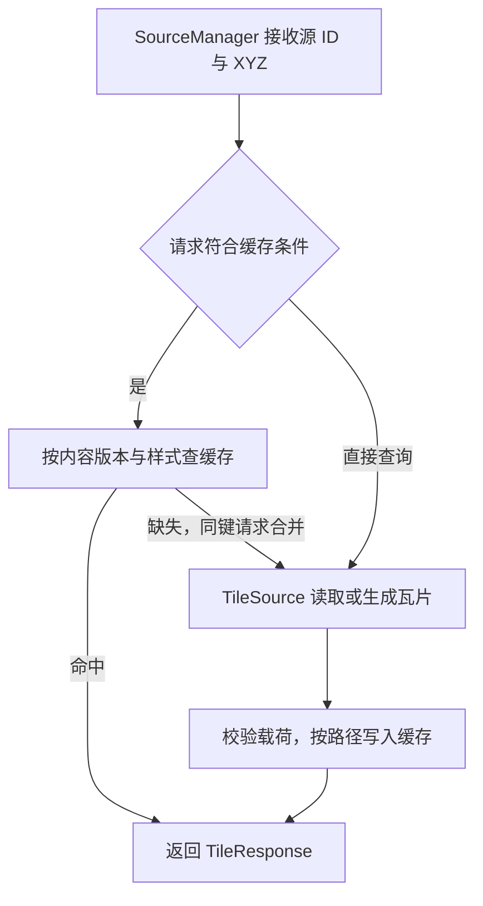

# 架构与生命周期

`maptile-core` 将数据访问、瓦片缓存、样式处理和地图渲染组织为可组合的 Rust 模块。应用构造具体数据源与配置，管理这些对象的生命周期，并将库返回的字节、元数据或图像接入自己的交互与服务流程。

公共模块见 [`src/lib.rs`](../src/lib.rs)，常用类型的导出入口见 [`prelude`](../src/prelude.rs)。

## 组件职责

| 组件 | 职责 | 应用的接入点 |
| --- | --- | --- |
| `TileSource` | 统一源标识、TileJSON、瓦片响应和关闭接口 | 实例化内置源，或实现自定义源 |
| `SourceManager` | 按 ID 管理源，协调缓存和查询，生成目录快照 | 注册、替换、查询与下线源 |
| `TileCache` | 按字节计权存储瓦片，管理 TTL/TTI，合并同键并发读取 | 配置缓存容量和有效期 |
| `filter` | 解析和验证 CQL2 属性条件，生成 SQL 片段 | 配置可查询字段和源的过滤路径 |
| `styles` | 读取样式、生成样式目录、重写资源 URL | 提供样式路径和应用资源地址 |
| `raster` | 解析并执行栅格样式相关处理，提供图像编解码组件 | 配置波段、色带、输出与重采样 |
| `render` | 构造地图请求、生成 WMTS 元数据；按 feature 执行原生渲染 | 创建渲染池，提交静态地图或瓦片请求 |
| `transport` / `transcode` | 压缩编解码与矢量瓦片格式转换 | 按响应编码和目标格式处理字节 |
| `discovery` / `watch` | 扫描文件，通知目录变化 | 将文件发现结果转换为具体数据源 |

应用层维护 HTTP 路由、鉴权、配置加载和资源地址，将这些上下文转为核心库需要的类型。字体和精灵图通过样式中的 glyph/sprite URL 接入，应用负责提供可访问的资源。

## 瓦片读取过程

管理器根据查询内容、源的缓存层级策略和已配置缓存，选择读取路径：

缓存条件包括：管理器已关联缓存、源的 `cache_zoom()` 包含当前层级，以及查询属于可缓存的输入组合。`filter`、`bbox` 和 `url_query` 走直接查询路径；样式与镶嵌像元选择参与缓存身份。实现和对应回归见 [`manager.rs`](../src/sources/manager.rs)。

`TileResponse` 携带实际字节、格式、压缩编码和可选修改时间。应用按本次响应的 `info` 处理结果。ETag 读取通过 `get_tile_with_etag` 返回新载荷及验证标识，或返回 `NotModified`。

管理器的普通读取和 ETag 读取都会拒绝非镶嵌源上的 `pixel_selection` 参数，包括源已禁用缓存的情况。直接调用具体源时，由调用方按该源支持的能力构造查询。

批量导出或归档构建可直接调用 `TileSource::read_tile_batch`。每次最多提交 128 个坐标，按 8 MiB 累计预算返回有序前缀，空瓦片保留其位置。非空请求至少返回一个结果，因此首张瓦片可占用超过累计预算的空间；调用方按已返回的长度继续剩余坐标。该入口直接读取源，具体预算和默认流程见 [`sources/mod.rs`](../src/sources/mod.rs)。

## 缓存身份与预算

瓦片结果缓存统一由 `SourceManager` 持有。Postgres 表源和函数源只负责读取与编码，直接调用源不会缓存瓦片；需要缓存时，将源注册到 `SourceManager::new().with_cache(cache)` 并通过管理器查询。源的 `cache_zoom()` 与 `content_version()` 仍决定管理器的缓存范围和内容身份。SQL 预编译缓存、归档目录缓存和数据集句柄缓存不属于瓦片结果缓存。

管理器不再用 `Some(empty_query)` 通知源跳过缓存，无参数请求直接传入 `None`。自定义源不能在管理器填充缓存时重入同一个缓存键；如果自定义源自行管理瓦片缓存，应关闭该源的管理器缓存策略。

动态组合源不缓存整个组，在线读取和 ETag 读取通过管理器缓存本次快照中的成员；请求期间成员重新注册不会改变该快照，下一次请求会使用新成员及其内容版本。批量读取继续直读源。静态组合源可缓存合并后的瓦片，首次合并直接读取其固定成员。

[`TileCacheKey`](../src/cache/tile_cache.rs)由源 ID、内容版本、XYZ 坐标和样式散列组成。栅格输出的有效样式与镶嵌像元选择通过规范化散列区分；同一坐标的不同内容或样式可以拥有独立缓存项。

FlatGeobuf 的 Unix 内容版本纳入完整 FileStamp，包含设备号、inode、ctime、长度与 mtime；其他平台每次打开使用新代次，克隆共享版本。同大小、同 mtime 的替换文件需要重新打开和注册，热缓存不会主动检查磁盘。固定栅格镶嵌还将成员范围纳入版本，因为范围决定本次瓦片的候选；全局统计继续保留全成员及上游 64 个资产的限制，见[成员范围说明](sources.md#固定栅格镶嵌与成员范围)。

内容版本由数据源提供。归档和文件源使用文件身份、对象校验信息或打开代次；PostGIS 表源可结合应用持久化的编辑修订号。COG 的 `content_id` 由应用给出，适合使用版本化 URI 或数据版本标识。自定义源通过 `content_version()` 声明自己的内容身份。

`TileCache::new` 接收容量、TTL 和 TTI。容量参数按 MiB 换算，权重包含瓦片载荷、键和记录开销；进程容量规划还应计入连接池、渲染器、数据解码与其他分配。同一缓存键的并发缺失请求共享一次计算，错误保留其结构化类型。

`invalidate_source` 和 `invalidate_all` 发起失效操作，后台维护完成物理回收。测试可调用 `run_pending_tasks().await` 等待维护处理。实现见 [`tile_cache.rs`](../src/cache/tile_cache.rs)，样式与内容散列见 [`hashing.rs`](../src/cache/hashing.rs)。

## 并发额度

`transport::configure_blocking_concurrency(limit)` 配置本 crate 经统一阻塞任务入口运行的解码、编码和其他 CPU/阻塞工作的进程共享额度。应用应在打开源或启动相关异步工作前调用一次；未配置时默认使用可用并行度，最多 16。显式配置可超过 16，须为正数且不超过 Tokio 信号量上限。重复配置或首次使用后配置返回 `Config`。同步编解码入口不经过此额度，原生渲染器仍使用其独立的池配置。

`raster::encode::to_png_async`、`to_jpeg_async`、`to_webp_async` 也通过上述共享额度准入。取消尚未开始的等待不会占用额度，已经开始的编码会持有额度至实际结束；已占同一额度的阻塞闭包应调用同步编码函数，避免同步等待异步包装。该统一准入是预算一致性增强，不代表已复现过载或 DoS。

Postgres 批量查询由每个连接池的 `PoolSettings.batch_concurrency` 控制，默认 2；池的克隆共享额度，分别调用 `connect` 创建的池互相独立。应用需将各池额度合计计入数据库预算。该额度在获取批量连接前占用；普通在线查询不占批量额度，但仍与批量查询共享池的连接数上限。

取消等待者不会提前归还仍在运行的阻塞任务或 SQL 清理任务的额度。数据库只有确认后端完成才归还额度；无法确认时停止该池的新批量准入，其他池不受影响。此时应先核实数据库残留任务，再重建受影响的池，避免旧任务和新额度叠加。

## 数据源生命周期

| 操作 | 管理器行为 | 适用场景 |
| --- | --- | --- |
| `register(source)` | 按 ID 插入或替换；替换为新对象时对旧对象调用 `start_close` | 应用启动、更新源配置、发布新文件 |
| `remove(id)` | 移除源并发起 `start_close`，返回旧源引用 | 调用方继续管理旧源的关闭过程 |
| `close_source(id).await` | 移除当前源、失效其缓存并等待 `close` | 数据源下线、显式资源回收 |
| `mark_unavailable(id)` | 按 ID 将当前源标为不可用并发起关闭；重复标记不重置退避或打断恢复 | 管理操作、记录首次加载失败 |
| `mark_unavailable_if_current(&source)` | 仅在当前注册对象仍是传入的同一个 `Arc` 时标记不可用并发起关闭 | 回报持有该实例的异步操作失败 |
| `recover_unavailable(id, factory).await` | 原子取得恢复资格、调用工厂并有条件发布结果，返回可用源 | 请求触发的单源恢复 |
| `require(id)` | 返回当前源，或返回对应的结构化错误 | 查询前解析源状态 |

每个 ID 的就绪和不可用状态保存在同一注册项中，注册、标记不可用和删除以单次状态更新完成。旧源的关闭钩子在释放注册表锁后调用；目录快照只包含就绪源。

异步操作回报源级故障时，保留该操作实际使用的 `Arc`，并调用 `mark_unavailable_if_current`。只有实例仍匹配时才返回 `true`；旧实例在替换或删除后回报失败会返回 `false`，不会改变当前注册项。内容版本相同的两个实例也分别判断。调用方负责区分源级故障与普通瓦片错误；不要在故障发生后重新按 ID 获取实例来回报。

`recover_unavailable` 对就绪源直接返回当前引用，对不存在的 ID 返回 `SourceNotFound`。不可用源经过 1 秒退避后，只有一个调用能执行工厂；退避期间和恢复进行中的其他调用立即返回 `SourceUnavailable`，不调用工厂，也不等待已有恢复。`unavailable_retry_due` 只提供当前是否可重试的观察值，不预留恢复资格。

恢复工厂必须返回同一 ID 的源，否则返回 `Config`。失败、取消或 panic 展开栈会释放本次恢复资格，并重新开始 1 秒退避。恢复期间发生 `register`、`remove` 或发现重载发布时，旧恢复结果不能覆盖新状态；调用改为返回当时的 `require(id)` 结果。未发布的工厂结果会开始关闭，仍注册着的同一个 `Arc` 保持打开。返回的源引用与普通 `require` 一样，之后仍可能被管理操作替换。

恢复资格按不可用注册项协调，不限制管理操作建立新代次后的工厂，也不接管工厂自行启动的后台任务。工厂负责清理尚未返回的资源；已经开始关闭的实例不能通过重新注册复活。

具体的会话释放过程由源实现。GeoParquet 和 FlatGeobuf 的克隆共享会话，显式 `close().await` 用于等待查询、连接和读取资源退出，详见[矢量文件指南](geoparquet.md)。

DuckDB 查询与 GeoParquet 远程打开只在阻塞闭包开始工作后发布中断句柄。局部守卫借用连接，并在中断共用的互斥锁下解除句柄；正常返回、错误和展开栈时，先等待在途中断退出，再释放连接或归还连接池。未启动的闭包没有已发布句柄，本地矢量导入也在同锁下解除中断句柄。这是针对已知析构窗口的预防性加固，未复现上游 UAF，也未改变锁定 DuckDB 依赖。

替换源后，若应用还需要等待旧对象完全关闭，应在替换前保留旧引用，再对该引用调用 `close().await`。`close_source(id)` 操作的是调用时按 ID 注册的当前源。

## 文件发现与更新

[`discovery::scan`](../src/discovery.rs)与 `scan_async` 扫描数据和样式文件，返回发现报告；[`SourceWatcher`](../src/watch.rs)通知文件变更。应用保留 watcher 并消费事件，把发现信息交给自己的数据源工厂。

watcher 默认保留 300ms 窗口的首个事件，并按种类补发尾沿，创建后迅速删除或原地覆写仍能触发终态重扫。事件通道与待处理路径表各最多 1024 项；拥塞时合并为 `Modified(root)`，在消费者恢复接收后重试，应用需据此重新扫描目录。Drop 会停止自有刷新线程，不等待消费者腾出队列，因此不能将它当作逐条无损事件日志。

MBTiles 在打开时固定相对路径对应的绝对别名，后续 chdir 不改变源身份；文件替换、WAL 更新和 symlink 目标切换仍触发旧源失效。

`reload_from_discovery` 根据 ID 同步新增与删除条目，就绪源保持当前对象。报告中仍存在的不可用源会重新调用工厂构建；报告中已消失的 ID 会被移除，包括不可用记录，并列入 `ReloadDelta.removed`。对已有文件内容或配置的更新，应用重新打开具体源，再调用 `register`。这让文件发布、元数据检查和内容版本更新具有明确的接入位置。

重载先构建全部新增和待恢复的源，再应用注册和删除。工厂失败或构建过程被取消时，本次变更尚未发布，原有不可用记录也保留，已构建但未发布的源开始关闭。成功后的应用阶段逐项执行；需要整个批次隔离的应用应协调并发写入，这个接口不提供跨 ID 的事务隔离。

工厂返回源的 `id()` 必须等于对应发现项的 ID。重载在发布前检查这一条件；不匹配返回 `Config`，并开始关闭本次已构建但未发布的源，保留原注册表状态。工厂若返回仍在注册表中的同一个 `Arc`，清理会保留该实例。

发现报告中的源 ID 必须唯一，即使对应源已经就绪也不能重复。重载在调用任何工厂或修改注册表前检查完整报告，重复则返回 `Config`；现有就绪源和不可用记录保持不变。标准 `scan` 已处理文件重名，手工构造或合并的报告也需遵守这一约束。

对于远程文件和对象存储，使用不可变、带版本的地址可以使数据快照与缓存身份保持一致。应用在发布成功后切换源，并按生命周期策略处理旧对象。

## 数据库与图像输入边界

PostgreSQL 连接显式选择 rustls ring provider，无需宿主初始化全局 provider。`prefer` 在 TCP 上先尝试 TLS，只有服务器明确不支持 TLS 才回退；`require` 必须通过证书链与主机名校验。`disable` 保持明文，Unix socket 可用 disable/prefer；锁定驱动仅接受这三种模式，详见 [TLS 连接](sources.md#tls-连接)。

PostGIS 表的普通、批量和过滤路径统一由 SQL 保留 MVT buffer 内的相交要素；普通和批量的 minzoom 短路不变。PostgreSQL 表/函数/OutDB 与独立 DuckDB 的坐标和 typed bbox 入口拒绝非法 XYZ 或非有限 bbox，返回 InvalidRequest；有限 bbox 保留各源既有语义，不自动新增日期线拆分。函数与 OutDB SQL 使用统一标识符转义，支持名称中的合法双引号。

PNG/WebP 编码将 1、3、4 波段的无效 mask 像素编码为透明像素，JPEG 继续忽略 alpha。Overlay 的括号、UTF-8 颜色和 polyline 整数边界通过解析检查处理，原生池的 panic guard 保留；URL 查询后缀按资源自身查询串合并到 fragment 前，并保留非查询后缀的直接追加用途。兼容性细节见[样式与渲染](rendering.md)。

## 错误与观测

[`MaptileError`](../src/error.rs)区分源状态、瓦片查找、配置、过滤和后端错误。应用可依据错误变体决定响应、重试或记录方式，并在对外输出时处理内部连接和文件上下文。

默认的栅格覆盖导出和像元查询在源不支持该能力时返回 `InvalidRequest`。这是请求与源能力不匹配，应用可以按无效请求处理。

渲染队列入队等待超时返回 `CapacityExhausted`。本地样式存储对未知样式 ID 返回 `StyleNotFound`；文件访问与 JSON 解析失败返回 `StyleFile { id, path, source }`，其 `source` 保留 `Io` 或 `Json`，供应用检查 `ErrorKind` 或解析位置。超过 16 MiB 的本地样式文件同样返回 `StyleFile`，其原因为 `PayloadTooLarge`。目录快照也保留这份样式上下文。具体分类见[样式与渲染](rendering.md)。

关键读取路径使用 `tracing`。启用 `metrics` 后，缓存计数器在首次访问时注册到默认 Prometheus registry，应用负责抓取和暴露；指标定义见 [`metrics.rs`](../src/metrics.rs)。连接数、源数量和原生渲染队列容量由应用按部署预算统一配置。
